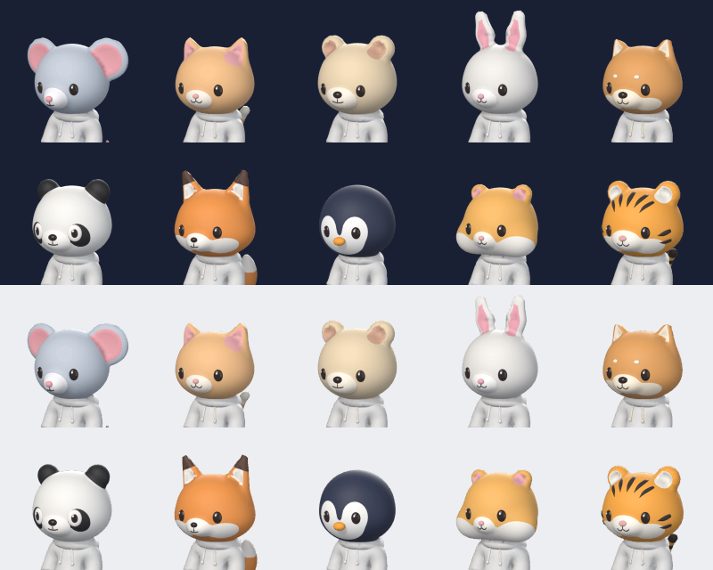

# 모두의 전광판 — 성장 분석과 밤사이 작업 보고

작성: 2026-11-21 새벽, 같은 날 낮에 2차 작업을 덧붙였다. 작업 브랜치 `commercial-build`. 밤사이 '상' 작업은 아침에 커밋·푸시·배포했고, 낮의 '중' 작업은 커밋·배포했다(푸시는 하지 않음). 오후에 GA 측정 ID를 넣어 한 번, 개인정보처리방침에 GA 문단을 넣어 또 한 번 배포했다. 같은 날 밤에 디자인과 UX 작업을 했고, 다음 날(11-22) 사장님이 "배포해 줘"라고 해서 배포했다. **가장 새로운 내용은 바로 아래 '5차 작업 보고'(2026-11-22 오후)다.**

> 이 문서는 세 부분이다. ① 지금 상태 진단과 방향, ② 상·중·하 분류, ③ '상' 구현 현황과 확인 방법.
> 구현 현황은 맨 아래 "3. '상' 구현 현황"에 있다.

---

## 5차 작업 보고: 상용 런칭 준비와 수익모델 (2026-11-22 오후)

### 한눈에

- 사장님 요청: "상용 서비스 런칭을 위해 무엇을 개선할지, 수익모델을 어떻게 강화할지 전략을 세워 상·중·하로 나누고 상부터 구현·검증을 반복해 끝까지."
- 전략과 계획은 [docs/launch-plan-2026-11-22.md](docs/launch-plan-2026-11-22.md), 법무·운영 확인 목록은 [docs/monetize-readiness-2026-11-22.md](docs/monetize-readiness-2026-11-22.md)에 있다.
- **계획한 상 6개, 중 6개, 하 3개를 모두 구현했다.** 독립 검토를 두 번 돌려 찾은 문제(예산을 바닥낼 수 있는 길, 스팸, 악성 꾸미기 id 등)도 고쳤다.
- 테스트는 988개에서 **1,164개**로 늘었고 1,157개 통과, 실패 0, 건너뜀 7(jsQR 미설치 1, 마이그레이션 상태별 6). 새 빌드 id는 `202611221326`이고 배포 번들(`wrangler deploy --dry-run`)이 만들어지는 것을 확인했다.
- **휴대폰 UX 정리 배포(2026-11-23 18:05 KST, 사장님이 "배포해 줘")**: 멍때리기 정면 시점과 글 줄 정리, 속보 위치, ⋯ 메뉴, 팝업 여백·버튼·입력. 버전 `b3ec53c0-2f52-43f2-9910-772d5aad3c0d`, 빌드 id `202611230850`. 되돌리기: `npx wrangler rollback f51df549-92a3-4c96-9b00-17651b031954`. 자세한 것은 `HANDOFF.md`의 '휴대폰 UX 정리'.
- **비게임 전환 배포(2026-11-23 07:39 KST, 사장님이 "배포해 줘")**: 응원 포인트, 선물 전광판, 약관·문구, 명당 응원 경쟁 네 갈래. 버전 `f51df549-92a3-4c96-9b00-17651b031954`, 빌드 id `202611231200`. 되돌리기: `npx wrangler rollback c63a393d-7f5b-4478-89d7-bdbce42a8ecb`. 자세한 것은 `HANDOFF.md`의 '비게임 전환'.
- **저녁 배포(2026-11-22 20:48 KST, 사장님이 "배포해 줘")**: 휴대폰 아래 줄 정리와 복주머니 배지, PC 위쪽 가운데 정리, 3D 복주머니, 리액션 24개 동작, 엄지 줄인 모델(`sw.js?v=10`), 공유 보너스 계정 전용, 봇 막기, 트래픽 수정, 광고 약관 검토. 이메일 인증과 Turnstile은 코드만 들어가고 꺼져 있다. 버전 `feb4fe8c-7813-4e5c-ba73-6501b0a3fdad`, 빌드 id `202611222045`. 되돌리기: `npx wrangler rollback 8a29833f-b682-4098-b2f4-9afd216afb53`. 용량 보고서는 `docs/capacity-2026-11-22.md`.
- **추가 배포(2026-11-22 18:05 KST, 사장님이 "배포해 줘")**: 휴대폰 작은 HUD(왼쪽 위 신분·코인 한 줄, 목표·계정 연결 한 줄 알약, 지갑 칩은 지갑 시트로, `화면만 보기` 눈 버튼). 버전 `8a29833f-b682-4098-b2f4-9afd216afb53`, 빌드 id `202611221803`. 되돌리기: `npx wrangler rollback e373c36e-7ecf-40c7-859f-551ecd81af3f`.
- **배포했다(2026-11-22 14:28 KST, 사장님이 "배포해 줘").** 버전 `e373c36e-7ecf-40c7-859f-551ecd81af3f`, 빌드 id `202611221326`. 공개 파일 147개가 커밋과 같고, 숨길 경로(서버 전용 `ops.js`·`adsrv.js` 포함)는 404, `/rt/health`의 새 칸으로 새 서버 코드가 실린 것을 확인했다. 되돌리기: `npx wrangler rollback 256d7ee8-5737-4bf4-a839-8d56ad47d604`. 푸시와 새 SQL(상점, 계절 테마)은 하지 않았다. 커밋은 이 PC의 `main`에만 있다.
- 같은 오후에 따로 한 것: 옷 색 16색과 후드티 색 미리보기, 커피(멍때리기) 소리를 제대로 된 곡으로, 휴대폰에서 동작 버튼을 이름과 함께 보이게, `main`으로 브랜치 합치기(푸시함).

### 수익모델 전략 (요약)

| 갈래 | 지금 | 이유 |
| --- | --- | --- |
| **광고 판매(현금)** | 만들었다. 스위치 `ADS_ON`으로 켠다 | 이 게임의 자산은 "사람들이 모이는 가상 타임스퀘어의 큰 화면"이다. 가게·크리에이터·팬덤(생일 광고)·개인(고백·축하)이 돈을 낸다. **게임의 점령 칸과 분리된 광고 전용 화면**에만 걸어서, 현금으로 게임 칸을 사는 일(Pay-to-win)이 없고 게임 아이템 판매도 아니다. 처음엔 계좌이체·세금계산서로 수동 결제. |
| **꾸미기 상점(코인 전용)** | 만들었다. 상점 SQL을 돌리면 열린다 | 코인이 빠져나갈 곳이 생겨 경제가 건강해지고 모으는 재미가 생긴다. 나중에 유료 코인을 열면 그대로 상품 목록이 된다. |
| **유료 코인 충전** | 만들지 않았다. 준비 문서만 | 게임물 등급분류, 청소년 결제, 환불, PG 계약이 필요하고, 코인 경매·코인 상금 추첨이 있어서 현금 코인이 들어오면 사행성 판단 위험이 크다. 순서: 광고 매출 → 재방문 지표 관문 → 법무 확인 → 추첨 정리 → 충전. |

### 상 (출시 전 필수)

| # | 항목 | 한 것 |
| --- | --- | --- |
| 상1 | 오류 수집 | 브라우저 오류를 개인정보 없이(닉네임·계정 id·주소 쿼리 없음) 표본으로 모아, 같은 오류끼리 묶어 관리자 '오류' 탭에. 서버 예외도 같은 곳에. |
| 상2 | 문의하기 | 설정 → 문의하기(버그·계정/코인·신고·광고/제휴·기타, 답장 이메일 선택). 관리자 '문의함'. 처리방침에 항목 추가. |
| 상3 | 운영자·사업자 정보 | Worker 변수 `OPERATOR_INFO`를 넣으면 약관·처리방침·설정 아래에 나온다. 값은 코드에 없다. |
| 상4 | 점검 모드 | 관리자 화면에서 켜고 끄면 입장 카드 대신 점검 안내(5분 안에 모든 서버에 퍼짐). 이미 들어온 사람은 쫓아내지 않고 한 번 알림. |
| 상5 | 상태 확인 | `/rt/health`가 DB 응답, 예산 단계, 점검, 빌드를 알려 준다. 외부 가동 감시를 붙일 수 있다. |
| 상6 | 광고 판매 | 광고 전용 화면 5곳, `/ads` 안내·신청 페이지, 관리자 검토·견적·입금·일정·송출, 기간이 끝나면 '게임이 센 수'로 정직한 리포트(공유 링크). 상품: 광고 화면 1일, 생일·응원 패키지, 밤 9시 60초 전체 화면. 가격은 `ADS_PRICES`가 없으면 '견적 문의'. |

### 중 (출시 직후)

| # | 항목 | 한 것 |
| --- | --- | --- |
| 중1 | 코인 꾸미기 상점 | 13종(이름표·발밑 링·택시 색·전광판 테두리·모자), 코인으로만, 다른 사람에게도 보임. 상점 SQL 전에는 '곧 열려요'. 주간 리그에 세지 않음. |
| 중2 | 광고 노출 집계 | 표본 세션이 2초 이상 가리지 않고 본 광고 화면을 센다. 계정과 손님을 나눠 보이고 손님 수가 약하다고 적는다. |
| 중3 | 검색·미리보기 | `robots.txt`, `sitemap.xml`, 설명 메타, 앱 아이콘 정리. 공유 카드·사진에는 `noindex`. |
| 중4 | 홈 화면 추가 유도 | 두 번째 방문 날부터, 뭔가 해 본 뒤에, 평생 한 번. 아이폰은 안내 그림. |
| 중5 | 주간 돌아보기 | 월요일 첫 입장 때 지난주 기록 카드(순위·코인·점령·하트·출석), 공유 가능. 지난주에 안 놀았으면 서버에 묻지도 않는다. |
| 중6 | 유료화 준비 문서 | 위의 체크리스트. |

### 하

| # | 항목 | 한 것 |
| --- | --- | --- |
| 하1 | 계절 소원 테마 | 수능·설날·추석·크리스마스·새해·발렌타인·빼빼로데이·어린이날 8가지. 시트 머리말, 예시 칩, 부팅 한 줄, 전광판 소원 카드 장식. 운영 달력이 우선. `?season=xmas`로 미리보기. |
| 하2 | 죽은 코드·중복 정리 | 한 번도 화면에 쓰이지 않던 건물 광고·사진 슬라이드 코드 등 제거(부팅 때 쓸데없이 그리던 2048px 캔버스도 없어짐). KST 날짜 계산을 한 곳으로. |
| 하3 | 프레임당 메모리 할당 | 결과가 비트 단위로 같은 것을 확인하며 줄였다: 택시·차 29.9KB → 8.1KB/프레임, 원격 아바타 12KB → 3.5KB, 전광판 8.2KB → 0.3KB/틱, 기도·만세 자세 5KB → 0.1~0.4KB. GC 횟수가 약 4분의 1. |

### 독립 검토가 찾아 고친 것 (중요한 것)

- 광고 리포트 페이지와 광고 클릭·노출 집계가 로그인 없이(또는 손님 토큰만으로) DO 호출을 무제한 일으켜 **하루 예산을 바닥낼 수 있었다** → 호출 전 IP·계정 제한, 예산 hard면 DO 호출 없이 답, 모르는 광고 id는 DO에 묻지 않음, 리포트는 1분 캐시.
- 문의함이 가득 차면 **안 읽은 문의부터 지워졌다** → 처리한 것부터 지우고, 다 안 읽은 것이면 새 문의를 거절. IPv6는 /64 단위로 제한.
- 광고 신청 스팸이 **하루 전체 신청을 막을 수 있었다** → 하루 300건 상한 대신 시간당 40건.
- 다른 사람이 `constructor` 같은 꾸미기 id를 보내면 **보는 사람 화면에서 오류**가 났다 → 안전한 조회와 서버 걸러내기.
- 상점에서 보인 가격과 실제 차감 가격이 최대 10분 다를 수 있었다 → 보인 가격을 함께 보내 다르면 거절.
- 운영 비용: 점검 상태와 광고 일정을 서버 조각마다 1분에 한 번 DB에서 읽던 것을 5분으로(무료 요금제 하루 10만 건 기준).
- 두 번째 검토(수정·정리 부분만)는 심각·중요 문제 없음. 작은 3건(밤 9시 직전 노출이 사라질 수 있음, 손님 문의 폭주가 계정 사용자 문의까지 막음, 가격 거절 뒤 상점이 닫혀 보임)을 고쳤다.
- 서버 전용 모듈 `ops.js`·`adsrv.js`가 공개 파일로도 나가게 되어 있던 것을 `.assetsignore`로 숨겼다(`worker.js`와 같게).

### 검증

- 각 항목은 에이전트가 만들고 테스트를 붙였고, 본 세션이 합친 뒤 전체 테스트를 매번 돌렸다.
- 브라우저(로컬, 휴대폰 390×844): 꾸미기 상점('곧 열려요' 상태), 문의하기(분류·광고 링크), `/ads` 페이지(예시 가격으로 켠 별도 서버), 광고 화면 다섯 곳이 장면에 있음, 계절 테마 부팅 줄, 순간이동 직후 E, `/rt/health`.
- **확인하지 못한 것**: 실제 광고 예약이 화면에 송출되는 모습(관리자 키가 필요해 로컬에서 진짜 키를 쓰지 않았다. 광고 에이전트가 가짜 키로 확인), 상점 구매(운영 DB에 상점 SQL이 없어서), 휴대폰 실기기, 홈 화면 추가 실제 설치 창.

### 사고 기록

- 한 에이전트가 자기 개발 서버를 끄면서 이름에 숫자가 겹친 `chrome.exe` 하위 프로세스 1개와 `bash.exe` 2개를 같이 종료했다. 브라우저·다른 작업에는 영향이 없었다. 이후 에이전트에게는 PID로만 끄게 했다.
- 한 에이전트가 다른 에이전트의 로컬 미리보기 탭에서 페이지 스크립트를 한 번 실행했다(로컬 서버, 데이터 쓰기 없음).

### 직접 하실 일

1. **배포 — 끝났다(2026-11-22 14:28, 버전 `e373c36e-…`).** 상점은 SQL 전이라 '곧 열려요', 광고는 `ADS_ON`을 넣기 전까지 꺼져 있다.
2. **운영 SQL**(안 돌린 것): `migrations/2026-11-22-shop.sql`(꾸미기 상점. **검토 수정으로 바뀐 최신 파일을 써야 한다**), `migrations/2026-11-22-themes.sql`(운영 달력의 새 계절 키). 코인 SQL 2부(옛 미확인 가입 1개)는 여전히 결정 대기.
3. **켜기 전 결정**: `OPERATOR_INFO`(사업자 정보), `ADS_PRICES`(광고 가격), `ADS_ON=1`. 광고 판매 전 법무 확인(환불 규정, 광고 심사 기준).
4. **Cloudflare Workers 유료 요금제($5/월)와 `PLAN=paid`**: 출시 전에 권한다. 무료는 하루 요청 10만 건이라 하루 수백 명이면 예산 가드가 걸린다.
5. **외부 가동 감시**: UptimeRobot 등으로 `https://studio.wishboard.workers.dev/rt/health`를 1~5분마다, `"db":"ok"` 키워드 감시.
6. **푸시 — 끝났다(2026-11-22 18시쯤, `b8dc6f9..c1654e4`).**
7. **정할 것**: 공유 보너스(하루 300코인, 손님 포함), 유료 코인 충전 여부와 시기(체크리스트 C), `tools/`의 임시 스크립트 셋.

---

## 4차 작업 보고: 남은 상·중·하 전부, 캐릭터 10종, 전광판 81칸 (2026-11-22)

### 한눈에

- `HANDOFF.md`의 '남은 것'을 상·중·하 모두 코드로 처리했다(주인만 할 수 있는 SQL 실행·배포·키 입력은 빼고). 캐릭터를 3종에서 **10종**으로, 점령 가능한 전광판을 61칸에서 **81칸**으로 늘렸다.
- **운영 SQL과 배포까지 끝났다(2026-11-22 11시, 사장님이 "SQL 실행 후 배포").** SQL 네 개(캐릭터, 전광판, 코인 1부, 예전 파일 1~4부)는 결과가 모두 `applied = true`였고, 배포는 버전 `256d7ee8-5737-4bf4-a839-8d56ad47d604`(빌드 id `202611221059`)다. 배포 뒤 공개 파일 122개가 커밋과 같고, 숨길 경로는 모두 404, `/rt/world`가 81칸, 새 손님의 코인 보내기가 새 문구로 거절되어 새 서버 코드가 실린 것을 봤다. 실서비스 화면에서 새 칸 STREET_37이 `빈 자리 · 지금 걸 수 있어요`로 열린 것도 봤다. 되돌리기는 `npx wrangler rollback b9c3aa62-1528-42f0-bb30-946ce052a782`. 같은 날 사장님이 "푸시해 줘"라고 해서 `commercial-build`를 GitHub에 올렸다(`aef1e9f..38ab22d`). 코인 SQL 2부(옛 미확인 가입 1개 확인 처리)는 실행하지 않았다.
- 테스트는 816개에서 **985개**로 늘었고 978개 통과, 실패 0, 건너뜀 7(jsQR 미설치 1, 마이그레이션 상태별로 스스로 건너뛰는 것 6). PGlite로 SQL 마이그레이션을 실제로 돌려 확인했다.
- 배포 번들은 `wrangler deploy --dry-run`으로 만들어지는 것을 봤다. 새 모델·썸네일·음악 모듈은 나가고 `.dev.vars`·SQL·`worker.js`·`tools/`·`test/`는 빠진다.
- 로컬 확인은 `wrangler dev`(운영 Supabase를 쓴다)에서 손님으로 들어가 보기만 했다. 점령·분양·코인 보내기는 하지 않았다. 손님 지갑 몇 개(이름 `브로드웨이곰22` 등)가 운영에 생겼다.
- 일하는 방식: 제가 전체를 나누고, 서브 에이전트 9개(Opus, 역할별 effort high)에 맡긴 뒤 하나씩 검토·합치고 브라우저로 확인했다. 독립 검토 에이전트가 찾은 코인 구멍 2개도 이번에 막았다.

### 1. 캐릭터 10종



| 번호 | 종 | 고른 이유 |
| --- | --- | --- |
| 1~3 | 쥐 · 고양이 · 곰 | 원래 셋(그대로, 파일도 바꾸지 않음) |
| 4 | 토끼 🐰 | 긴 귀로 멀리서도 한눈에 구분되는 대표 귀여운 동물 |
| 5 | 강아지 🐶 | 시바풍. 한국에서 가장 많이 키우고 좋아하는 동물 |
| 6 | 판다 🐼 | 푸바오 이후 한국에서 인기가 가장 큰 동물 중 하나 |
| 7 | 여우 🦊 | 큰 꼬리와 뾰족한 귀, 실루엣이 확실히 다름 |
| 8 | 펭귄 🐧 | 남녀노소 호감, 머리 모양이 완전히 달라 구분 쉬움 |
| 9 | 햄스터 🐹 | 통통한 볼, 작고 동그란 귀 |
| 10 | 호랑이 🐯 | 한국을 상징하는 동물(K-점령전), 줄무늬 |

- 모두 이 게임용으로 새로 만든 **일반 동물**이다. 카카오프렌즈·라인프렌즈·뽀로로·포켓몬 같은 기존 캐릭터는 본뜨지 않았다. 직접 Blender 스크립트로 만들었고(`tools/blender/build_animal.py`), 뼈대와 동작 10개는 기존과 같은 Mixamo 것이다.
- 종마다 0.74~0.83MB, 삼각형 9~11천 개. 후드티만 이름표 색으로 물든다(게임 안 여우에 보라 후드티를 입혀 확인).
- 캐릭터 고르기는 5칸×2줄 썸네일 타일이다(320px 휴대폰에서도 넘치지 않음).
- 처음에는 내 종 하나만 받는다. 다른 종은 화면에 보일 때, 그리고 입장 1분 뒤 방에 있는 사람들이 입은 종만 최대 3개 미리 받는다(10종을 다 받지 않게).
- **DB 마이그레이션 전에도 동작한다.** 운영 DB는 지금 종 1~3만 저장하지만, 고른 4~10은 같은 기기에서 유지되고 다른 사람에게도 보인다. `migrations/2026-11-22-species.sql`을 돌리면 다른 기기에서도 따라간다.

### 2. 전광판을 늘릴까? — 판단과 결과

**늘렸다. 61칸 → 81칸(타임스퀘어 안 43 → 63).** 이유:
- 지금 운영에는 실제 이용자가 거의 없다(불 켜진 칸 3개, 나머지는 만료된 봇·점검용). 지금 문제는 '자리 경쟁'이 아니라 '들어와서 내 것이 생기는 경험'이다. 칸이 많을수록 첫 방문자가 자기 칸을 가질 확률이 높고, 내 칸 보러 다시 오고 친구를 부른다.
- 무료 첫 칸 목록이 12칸에서 20칸으로 는다(마이그레이션 뒤).
- 가장 싼 입문 칸(150~250코인)이 생긴다. 메인 타워·코너의 희소성은 그대로다.
- 진짜 타임스퀘어는 벽 전체가 화면이다. 지금은 화면이 듬성듬성해 보였다.
- **사람이 흩어지지 않게** 새 칸은 모두 사람이 모이는 보타이 안(광장 중심 120m 안)에만 넣었다. 눈높이 칸 13개(걸으면서 가까이 보임)와 기존 큰 칸 위에 겹쳐 올린 칸 7개.

그 과정에서 고친 것:
- 지도에서 옆 건물 안에 묻혀 있거나 막힌 안뜰에 있어 **거리에서 안 보이던 칸 13개**(기존 11 + 새 2)를 모두 보이는 곳으로 옮겼다. 8개는 붕어빵 포차 맞은편 벽에 모여 '전광판 벽'이 됐고, 나머지는 원 타임스퀘어 옆면과 TKTS 쪽 7번가로 갔다. 운영에서 모두 빈 칸이라 지금 옮겨도 아무도 손해가 없다.
- 세로 화면에서 일부 칸의 양옆이 잘리던 문제(HANDOFF '세로 화면의 거리 전광판')를 카메라 자리 고르기로 고쳤다. 이제 50개 거리 칸 모두 세로·가로 화면에서 면 전체가 들어온다.
- 휴대폰(낮은 품질)은 거리 칸 그림을 384×216으로 줄여, 칸이 20개 늘었는데도 그래픽 메모리가 약 28MB에서 23MB로 줄었다.
- **마이그레이션 전**: 새 칸은 보이지만 DB에 줄이 없어 `곧 열려요`로 나오고 점령 버튼이 눌리지 않는다. `migrations/2026-11-22-boards.sql`을 돌리면 열린다.

### 3. HANDOFF '남은 것' 처리 결과

| 급 | 항목 | 한 것 |
| --- | --- | --- |
| 상 | 계정 코인 보내기 하한 | 선물 코인은 남에게 넘길 수 없다. **손님은 보내기·모금 불가**, 계정은 **580코인**(한 계정이 받을 수 있는 선물의 최대: 시작·첫 방문 코인 두 벌 + 연결 보상) 넘게 모은 만큼만 보낸다. 새 아이디를 만들어 코인을 빼던 길이 닫혔다. 전광판·분양에 쓰는 것은 그대로. |
| 상 | 탈퇴한 토큰으로 지갑 재생성 | 탈퇴 전에 받은 토큰은 보내기·모금·연결이 거절된다(401). 마이그레이션 뒤에는 로그인 정보가 없는 계정은 지갑 자체가 생기지 않는다. |
| 중 | 탈퇴 후 재가입 코인 | 연결 보상 300은 다시 주지 않는다(그대로 유지). 연결할 때 그 이유를 한 번 알려 준다. |
| 중 | 개인정보처리방침·약관 | 구글 로그인이 이메일·이름·사진 주소를 인증 서버에 저장한다고 정확히 적었다. 방문 통계(GA)는 켜진 채로 두고 설정에 **`방문 통계 보내지 않기`**를 넣었다(브라우저의 GPC 신호도 따름). 약관 탈퇴 조항을 실제 동작(로그인 정보까지 삭제)에 맞췄다. 시행일 2026-11-22. |
| 중 | 아이디 계정 비밀번호 분실 | 가입 화면에 '잊으면 찾을 수 없다, 구글 연결 권장' 경고. 로그인한 아이디 계정은 설정에서 **비밀번호 바꾸기** 가능. |
| 중 | SQL 1·3·4부 | 실행하지 않았다(아래 '직접 하실 일'). 전광판 마이그레이션 2부가 1부(무료 첫 칸) 일까지 함께 한다. |
| 하 | 카카오톡 공유 | 보류 그대로(키 필요). |
| 개선 | 코인 가드의 틈 | 계정 연결과 시작 코인 회수를 DB 한 트랜잭션으로(마이그레이션). 일일 예산 hard에서는 보내기·연결을 **막는다**(가드를 건너뛰지 않음). 탈퇴 표시를 `GUEST_KEY`와 무관하게 DB에 둔다. 손님 여럿을 한 계정에 이어 붙여 첫 방문 코인을 모으던 길, 빈 손님을 버리는 계정에 먼저 붙이는 우회도 막았다. 공유 보너스·코드 입력이 isolate마다 다시 지급될 수 있던 것도 막았다(검토에서 발견). |
| 개선 | 작은 화면 4건 | 휴대폰 가로: 독이 점프 버튼·지도·위치 알약을 덮던 것 → 독을 점프 버튼 옆 열로. 568px 가로 택시 HUD 239px → 448px. 374px 미만 둘러보기 안내가 두 줄로 토스트와 겹치던 것 → 한 줄. 데스크톱 속보 줄과 길안내 알약 겹침 → 비켜나게. 브라우저에서 각 크기로 재서 확인. |
| 개선 | 세로 화면 거리 전광판 잘림 | 위 2번. |
| 개선 | 로그아웃 뒤 받은 소식·🔔 | 로그아웃하면 지운다. 아이디 로그인 중 시트를 닫으면 오류를 토스트로. |
| 개선 | 배경음악 파일 없음 | 파일 대신 **브라우저에서 합성하는 원곡 3곡**(광장 로파이, 택시 신스웨이브, 밤 이벤트). 효과음 아래 크기, 멍때리기·댄스 중에는 잦아든다. 저작권 문제 없음. |
| 개선 | 순간이동 직후 E 무반응 | 원인을 찾았다: 앞 전광판을 0.25초마다만 다시 찾아서, 그 사이에 누르면 '근처 없음'이었다. 순간이동 때와 빈 E 때 바로 다시 찾게 고쳤다(브라우저에서 순간이동 직후 E로 창이 열리는 것 확인). |
| 정리 | 작업 워크트리 12개 | 모두 합쳐진 것을 확인하고 지웠다. |
| 정리 | `tools/acorn-ui.mjs` `paren-check.mjs` `snippet.js` | 11-20 밤에 만들어진 `ui.js` 문법 검사용 임시 스크립트다. 지우지 않고 남겼다(아래 결정). |
| 정리 | 운영 점검 지갑·`PLOT_9`/`10` | 운영 SQL이라 손대지 않았다. `PLOT_9`/`10`은 11-24에 스스로 꺼진다. |

### 직접 하실 일

1. **운영 DB SQL — 끝났다(2026-11-22).** 아래 네 개를 실행했다. 남은 것은 코인 2부 결정뿐이다.
   - `migrations/2026-11-22-species.sql` — 캐릭터 4~10을 DB에 저장(다른 기기에서도 따라감).
   - `migrations/2026-11-22-boards.sql` — 새 전광판 20칸 열기 + 무료 첫 칸 20칸(옛 SQL 1부 포함).
   - `migrations/2026-11-22-coins.sql` 1부 — 코인 가드를 DB로. 2부(주석)는 이메일 확인이 켜져 있던 동안 가입해 로그인이 안 될 수 있는 옛 계정을 확인 처리하는 것으로, 1부 결과에 그 수가 나온다. 돌릴지 정해 주세요.
   - `migrations/2026-11-21-mid.sql` 전체(1·2부는 이미 반영되어 그대로, 3부 받은 소식 읽음, 4부 소속 지붕).
2. **배포 — 끝났다(2026-11-22 11:11, 버전 `256d7ee8-…`).**
3. **푸시 — 끝났다(2026-11-22).**
4. **정할 것**
   - 공유 보너스: 하루 300코인, 손님도 받는다. 하한 580에 들어가지 않아 새 계정이 첫날 300을 보낼 수 있다. 금액을 줄이거나 계정만 받게 할지.
   - 보내기 하한 580이 너무 높은지(보내기는 '광고주에게 코인 보내기'뿐이라 일반 이용자 영향은 작다).
   - `GUEST_KEY`를 바꿀 일이 있으면 코인 마이그레이션을 먼저 돌린 뒤에.
   - `tools/`의 임시 스크립트 셋을 지울지.
5. **실기기 확인**(이번에 더해진 것): 캐릭터 고르기와 새 캐릭터 모습, 휴대폰 소리 켰을 때 배경음악, 휴대폰 가로에서 독·점프 버튼 배치, 붕어빵 포차 맞은편 전광판 벽. 예전 목록(구글 로그인 새 창, 카카오톡 인앱, 안드로이드 뒤로 가기 등)도 아직 남아 있다(`HANDOFF.md`).

---

## 3차 작업 보고: 디자인 A '밤의 네온'과 UX 전면 점검 (2026-11-21 밤)

### 한눈에

- 화면 전체의 색과 그래픽을 방향 A('밤의 네온')로 새로 입혔고, 캐릭터 셋(쥐·고양이·곰)을 Blender로 새로 만들었고, 기능마다 버튼·카메라·효과를 점검해 고쳤다.
- **배포했다(2026-11-22, 사장님이 "배포해 줘").** 커밋 `29c3bb6`, 버전 `b9c3aa62-1528-42f0-bb30-946ce052a782`. 배포 뒤 공개 파일 103개가 커밋과 같고(`tools/prod-check.mjs`, 문제 없음), 숨겨야 할 경로는 모두 404, `/rt/config`에 `invite: true`가 그대로 있다. 새로 만든 손님으로 코인 보내기를 시도해 `starter` 거절이 오는 것으로 새 서버 코드가 실린 것을 봤고, 실서비스 화면에서 입장·이동·새 캐릭터·새 HUD를 봤다. **푸시는 하지 않았다.** 커밋은 이 PC에만 있다.
- 되돌리기: `npx wrangler rollback 90788ab2-a601-4530-bd32-46f317016e76`(이전 실서비스, 친구 초대 켠 상태). 되돌린 뒤 `/rt/config`에 `invite: true`가 있는지 본다.
- 전후 비교 화면: https://claude.ai/artifact/3rY54PjC4KMALDXo8bWbWj (사장님 계정으로만 열린다.)
- 테스트는 507개에서 816개로 늘었고 전부 통과한다. 새 빌드 id는 `202611212346`이다.
- 운영에서 바뀐 것은 Supabase 인증 설정 세 가지뿐이다(사장님이 "바꿔줘"). Site URL을 `https://studio.wishboard.workers.dev`로, Redirect URLs에 실서비스와 `http://localhost:8790`을 넣고, 이메일 확인을 껐다. 그 전에는 구글 로그인이 게임으로 돌아오지 못했고 아이디 가입은 로그인이 되지 않았다. 아이디 가입과 로그인은 시험 계정으로 확인했다.
- 탈퇴 때 로그인 정보를 지우는 SQL(`migrations/2026-11-22-forget-login.sql`)은 사장님이 "실행해 줘"라고 해서 2026-11-22에 운영 DB에 실행했다(아래 "직접 하실 일" 2).

### 무엇이 달라졌나

- **색과 그래픽.** 남색 바탕 한 벌, 강조색은 호박색 하나, 도구 줄과 시트 제목은 선 아이콘 66개. 전광판은 어두운 판에 흰 글자, 건물은 불 켜진 창이 열에 하나이고 1층은 상점 띠, 바닥은 젖은 밤길이다. 바닥과 벽은 셰이더로 그려서 사진 텍스처를 받지 않는다.
- **캐릭터.** 세 종을 직접 만들었다(구입한 모델 없음). 동작 열 가지와 뼈대만 Adobe Mixamo 것이다. 종마다 0.8MB 안팎, 후드티 색이 이름표 색을 따라간다.
- **계정.** 구글 로그인은 새 창에서 하고 게임 화면을 떠나지 않는다. 로그인 시트는 구글 버튼, 아이디 폼 순서이고 오류는 시트 안에 한국어로 나온다. 로그아웃이 생겼다. 탈퇴는 따로 확인하는 화면이다. 한 탭에서 로그인·로그아웃하면 다른 탭도 따라간다.
- **시트와 뒤로 가기.** 시트는 쌓이고 한 겹씩 닫힌다. 광장에서 뒤로 가기는 한 번 더 눌러야 나간다. 쓰던 글이 있으면 바깥을 눌러도 닫히지 않는다. 좁은 화면의 전광판 창은 미리보기만 위에 남고 입력 칸과 점령 버튼이 보인다(전에는 가려서 보이지 않았다).
- **카메라.** 전광판 보기·점령 축하·관람은 화면 비율에 맞춰 면 전체가 들어오는 거리에 선다. 점령 축하 폭죽은 전광판 옆과 위에서만 터진다. 관람 중에는 왼쪽 패널과 지도가 숨는다.
- **조작.** 터치 스틱은 누른 자리에서 뜬다. 택시 안내는 "손님 기둥 / 도착 기둥"으로 통일했고 달리는 중에 내리면 먼저 멈춘다. 붕어빵은 세 번 뒤집기다. 5,000코인 장악은 한 번 더 확인한다. 멀리 있는 전광판을 누르면 이름·거리와 보기·응원·걸기 버튼이 뜬다.
- **문구.** "메인거리을 가져갔어요" 같은 조사 오류를 화면, 받은 소식, 푸시 알림에서 고쳤다.

### 리뷰가 잡아서 고친 것 가운데 큰 것

- 로그아웃 → 새 손님 → 로그인을 되풀이하면 100코인씩 늘던 것(시험 계정으로 456 → 556을 직접 봤다). 지금은 0이 더해진다.
- 탈퇴 → 재연결을 되풀이하면 연결 보상 300을 매번 받던 것. 손님이 시작 코인을 남에게 보내거나 소속에 모금하던 것.
- **탈퇴가 로그인 정보를 지우지 않던 것.** 탈퇴시킨 시험 계정에 같은 아이디·비밀번호로 다시 로그인이 됐다. Worker가 지우려고 부르던 주소가 아무 일도 하지 않는 호출이었다(이번 작업 이전부터).
- 다른 탭에서 로그인하면 이 탭은 화면은 손님인데 요청은 계정 이름으로 나가던 것.
- 도시를 불러오는 동안 붕어빵을 시작하면 이동이 영영 막힐 수 있던 것.
- 멀리 누른 전광판 카드의 버튼이 눌리지 않던 것, 세로 화면에서 전광판이 양옆으로 잘려 보이던 것, 점령 축하 폭죽이 전광판과 공유 사진을 가리던 것.

### 정해 주실 것 (상·중·하)

| 급 | 항목 | 내용 |
| --- | --- | --- |
| 끝 | 탈퇴 때 로그인 정보 지우기 | 2026-11-22에 SQL을 실행했다. 이제 탈퇴하면 로그인 정보까지 지워진다("직접 하실 일" 2). |
| 상 | 계정의 코인 보내기 하한 | 아이디 가입은 이메일 확인이 없어서, 새 아이디를 만들어 400코인(시작 100 + 연결 300)을 본계정 전광판 주인에게 보낼 수 있다. 또 탈퇴한 계정은 토큰이 살아 있는 동안(길게는 1시간) 프로필만 읽어도 100코인 지갑이 다시 생겨 그것을 보내고 다시 탈퇴할 수 있다. 계정에도 하한을 두면 막힌다(100이면 둘째 길만, 400이면 둘 다). 두면 정상 이용자도 그만큼은 못 보낸다. |
| 중 | 탈퇴 후 재가입은 0코인 | 보상을 되풀이해 받는 것을 막느라, 탈퇴했던 계정(같은 이메일)은 연결 보상 300과 시작 코인 100이 다시 붙지 않는다. 시작 100은 남기길 원하면 바꾼다. |
| 중 | 개인정보처리방침 | "실명은 수집하지 않습니다"라고 적혀 있지만 구글 로그인은 프로필 이름을 Supabase 인증 쪽에 저장한다(게임 화면에는 쓰지 않는다). 방문 통계는 동의 전에 켜진다. 문구를 고칠지 동작을 바꿀지. |
| 중 | 아이디 계정의 비밀번호 분실 | 실제 이메일이 없어서 재설정 메일을 보낼 수 없다. 가입 화면에 적을지, 이메일 가입만 받을지. |
| 중 | 예전 미확인 가입 | 이메일 확인이 켜져 있던 동안 가입한 계정은 `auth.users`에 미확인 상태로 남아 로그인이 안 될 수 있다. |
| 하 | SQL 1·3·4부 | 무료 첫 칸 12칸, 받은 소식 읽음 표시, 소속 지붕. 그대로다. 1부가 없어서 "무료 첫 칸" 마법사는 이번에 화면으로 확인하지 못했다. |
| 하 | 푸시 | `git push origin commercial-build`를 할지. 원격은 `cf370b5`에 있다. |
| 하 | `C:\ref\` | 캐릭터 참고 이미지 19장이 남아 있다. 지워도 된다. |

### 직접 하실 일

1. **배포는 끝났다.** 문제가 보이면 `npx wrangler rollback 90788ab2-a601-4530-bd32-46f317016e76`로 되돌린다.
2. **SQL 실행(탈퇴 때 로그인 정보 지우기). 끝났다(2026-11-22, 사장님이 "실행해 줘").** Chrome의 Supabase SQL 편집기에서 먼저 읽기만 하는 조회로 실행 역할(`postgres`), 함수가 아직 없는 것, Worker 키가 있는 것을 봤다. 파일 전체를 붙인 뒤 편집기 안의 글이 커밋된 파일과 SHA-256까지 같은 것을 확인하고 실행했다("Run without RLS"). 결과는 `applied = true`, `적용됨. 주인 postgres. 없는 계정으로 시험 호출해 0줄 삭제를 확인했습니다`이고, 실행 직후 로그인 수는 그대로(3)였다. 실서비스 `/rt/config?forget=1`은 바로 `forget: true`를 줬다. 이어서 시험 계정을 탈퇴시켰더니 응답이 `{"ok":true,"login":"deleted"}`였고, 로그인 수가 3에서 2가 됐으며 그 계정의 `auth.identities`·`auth.sessions`·지갑 줄은 0이고, 같은 아이디로 다시 로그인하면 `아이디 또는 비밀번호가 맞지 않아요`가 나온다. 남은 로그인 2개는 손대지 않았다. 아래는 다시 실행할 때를 위한 원래 안내다.
   - Supabase `wishboard` 프로젝트의 SQL 편집기에서 역할은 그대로(`postgres`) 두고 `migrations/2026-11-22-forget-login.sql` 전체를 붙여 한 번 실행한다. "destructive operation" 경고는 예상한 것이다(함수 본문에 DELETE가 있을 뿐, 파일이 계정을 지우지는 않는다). `kts_forget`에 대해 물으면 **Run without RLS**를 누른다(임시 표다). 결과는 한 줄이고 `applied`가 `true`, `note`가 `적용됨. 주인 postgres. 없는 계정으로 시험 호출해 0줄 삭제를 확인했습니다`여야 한다. `false`면 `note`가 이유를 말하고, `postgres`로 다시 실행하면 된다. 배포 전에도 후에도, 몇 번을 실행해도 된다. "실행해 줘"라고 하면 지난번 2부처럼 대신 실행하고 확인한다.
   - 실제 Supabase에서 로그인 정보가 지워지는 것은 아직 못 봤다(테스트는 PGlite에서 돌렸다). 실행한 뒤 시험 계정을 탈퇴시켜 `/rt/auth/withdraw` 응답이 `"login":"deleted"`인지, Authentication > Users에서 사라지는지, 같은 아이디로 로그인이 안 되는지 본다.
   - 함수가 생기기 전에 탈퇴한 계정의 로그인 정보는 남아 있다. 찾는 조회는 그 파일 머리말에 있다(지갑 줄이 없는 로그인).
3. **본인 구글 계정으로 로그인해 본다.** 새 창이 뜨고, 끝나면 창이 닫히며 게임에 `계정을 연결했어요`가 나오는지.
4. **휴대폰.** 카카오톡 안에서 연 링크가 바깥 브라우저로 넘어가는지(`kakaotalk://web/openExternal` 길은 실기기에서 못 봤다), 안드로이드 뒤로 가기, 키보드가 시트를 가리지 않는지, 푸시 알림을 눌렀을 때 게임이 새로 시작되지 않는지, 세로·가로 화면에서 겹치는 것이 없는지.

### 실서비스에 남긴 것

- 시험 계정 `kts-test-p84ntt@id.wishboard.dev`는 모두 지웠다(지갑, `PLOT_6`, 시험용 20,000코인, 로그인 정보). Meter `acct`에 그 계정의 탈퇴 표시(해시)만 남는다.
- 배포 뒤 점검으로 손님 두 명이 생겼다(하나는 코인 보내기 거절을 본 것, 하나는 브라우저로 입장한 것). 보통 방문자와 같은 흔적이다.
- 그 밖의 흔적은 2차 보고의 것 그대로다(점검 지갑, `PLOT_9`, `PLOT_10`).

### 어떻게 만들고 검증했나

- 구현 에이전트 13개(색·그래픽 4개가 두 바퀴, 캐릭터 1개, 계정·시트·점령 흐름·카메라·조작·서버 가드 6개, 마지막 수정 2개), 감사 2개(48건), 리뷰 3개(40여 건). 각자 분리된 작업 폴더에서 서로 다른 파일만 고쳤고, 병합과 충돌 해결, 브라우저 확인은 내가 했다. 서버 가드는 리뷰 뒤 두 번 더 돌았다.
- 브라우저 확인은 로컬 서버(실제 Workers 런타임, 운영 DB)에서 770px 폭 창으로 했다. 본 것: 입장, HUD, 로그인·로그아웃·재로그인, 두 탭 동기화, 내 전광판과 수정 시트, 60초 장악 확인 단계(실행은 하지 않음), 붕어빵, 택시, 관람, 점령과 축하 줄, 멀리 누른 카드, 빼앗김 알림, 탈퇴(SQL 실행 전 경로).
- 합친 뒤 내가 직접 고친 것: 작은 전광판에서 카메라가 너무 멀던 것, 관람 중 HUD가 전광판을 가리던 것, 조작 안내 카드와 E 안내의 겹침, 붕어빵 패널 위의 토스트, 조사 오류.

### 확인하지 못한 것

- 구글 팝업 로그인(실제 구글 계정 필요), 휴대폰 실기기 전부. 휴대폰 화면의 겹침은 스타일 계산과 테스트로만 봤다.
- 새로 온 사람의 "무료 첫 칸" 마법사(운영 DB에 1부가 없어서 뜨지 않는 것으로 보이는데, 코드로 확인하지는 않았다).
- `forget_login`이 실제 Supabase에서 `auth.users` 줄과 딸린 세션을 지우는지.
- 일일 예산 hard 단계에서의 동작(가드가 기록을 읽지도 쓰지도 않는 길)은 테스트로만 봤다.
- 로컬에서 E 키가 한 번 반응하지 않은 적이 있다(전광판 앞으로 순간 이동한 직후). 다시 나오지 않았다.

---

## 2차 작업 보고: '중' 15개 (2026-11-21 낮)

### 한눈에

- '중' 15개를 모두 구현해 `commercial-build`에 커밋하고 실서비스에 배포했다. 배포한 커밋은 `9a46227`, 버전은 `83317443-b5e4-42bf-952c-3997b3af7e1c`, 빌드 id는 `202611211159`다. **푸시는 하지 않았다.** 커밋은 이 PC에만 있다.
- 같은 날 오후 GA 측정 ID `G-ZHXT5BEQ4J`를 `index.html`에 넣어 한 번 더 배포했다. 커밋 `468ed75`, 버전 `2a6b48b0-f61b-4931-b478-1eda9cee22d5`. 바뀐 공개 파일은 `index.html` 하나다. 배포 뒤 공개 파일 116개가 커밋과 같고, GA 실시간 보고서에 실서비스 방문(`page_view`, `page_landing`)이 들어오는 것을 봤다.
- 이어서 개인정보처리방침에 "방문 통계 (Google 애널리틱스)" 문단을 넣고, 로그인 코드가 Google로 가던 것을 막아 다시 배포했다. 커밋 `f3edf9f`, 버전 `ca69bc79-b962-4752-8d97-fd332ca32d57`. 바뀐 공개 파일은 `legal.js`와 `index.html` 둘이고, **지금 실서비스는 이 버전이다.** 배포 뒤 공개 파일 116개가 커밋과 같고, 실서비스 `/?policy=privacy`에 새 문단이 보인다.
  - 막은 것: GA를 켠 뒤로, 로그인하고 돌아온 주소의 `?code=`와 기기 이동 링크의 `?handover=`(15분짜리 티켓)가 주소 그대로 Google에 갔다. Google 태그는 실릴 때의 주소를 첫 `page_view`로 보내고, 페이지에서 주는 `page_location`·`send_page_view` 설정으로는 그것이 바뀌지 않았다(둘 다 해 봤다). 그래서 주소에 그 값이 남아 있는 동안에는 태그를 싣지 않는다. 앱이 값을 읽고 주소에서 지우면(보통 몇 초) 그때 싣고, 그사이 이벤트는 기다렸다가 나간다. 30초가 지나도 남아 있으면 그 방문은 GA에 잡히지 않는다(관리자 화면 퍼널에는 잡힌다).
  - 오후 첫 GA 배포부터 이 배포까지 몇 시간 동안은 그 값이 Google에 갔을 수 있다. `code`는 그 브라우저에 있는 짝 값 없이는 못 쓰고 한 번 쓰면 끝이며, `handover` 티켓은 15분 뒤 죽는다. 그 주소는 GA 보고서의 페이지 주소에 남아 있을 수 있고, 보는 사람은 속성 주인(사장님)과 Google이다.
- 테스트는 260개에서 507개로 늘었고 전부 통과한다.
- 실서비스 점검: 공개 파일 116개가 커밋과 바이트 단위로 같다. 시험 계정 점검은 58개 가운데 57개 통과, 실패 0, 건너뜀 1(SQL을 실행해야 보이는 읽음 표시)이다.
- 친구 초대(중1)는 꺼 둔 채 배포했다가, 사장님이 "켜줘"라고 해서 2026-11-21 저녁에 **켰다**(아래 "직접 하실 일" 3). 지금 실서비스 버전은 `90788ab2-a601-4530-bd32-46f317016e76`이고 코드는 `f3edf9f` 그대로다(시크릿 `INVITE_ON`만 더해졌다).
- 세 가지는 사장님이 SQL을 한 번 실행해야 완전히 켜진다(무료 첫 칸 12칸, 받은 소식 읽음 표시, 소속 지붕을 방문 없이 정하기). 실행 전에도 게임은 지금과 똑같이 동작한다. 네 번째였던 "탈퇴 시 옛 푸시 구독 삭제"(2부)는 사장님이 "중14 진행"이라고 해서 2026-11-21 저녁에 2부만 운영 DB에 실행했다(아래 "직접 하실 일" 2).
- 카카오톡 공유(중10)는 사장님 결정으로 **보류**다. 키가 없으니 버튼도 요청도 없다.
- 되돌리기: 방침 문단과 코드 차단만 되돌리려면 `npx wrangler rollback 2a6b48b0-f61b-4931-b478-1eda9cee22d5`(GA만 켠 배포본. 로그인 코드가 다시 Google로 간다). GA까지 끄려면 `npx wrangler rollback 83317443-b5e4-42bf-952c-3997b3af7e1c`('중' 배포본, GA 없음). '중' 전체를 되돌리려면 `npx wrangler rollback e3554d17-1d4b-40df-b20a-a1c442a161fa`('상' 배포본). 되돌려도 실행한 SQL과 새로 쌓인 리그·리포트 기록은 남고, 옛 코드는 그것을 무시한다.

### '중' 15개 현황

| 번호 | 항목 | 상태 | 알아 둘 것 |
| --- | --- | --- | --- |
| 중1 | 친구 초대 양방향 보상 | 켜짐 | 둘 다 100코인. 서비스 전체 하루 40건(8,000코인)까지. 2026-11-21 저녁에 켰다. 보상이 실제로 나가는 것은 실서비스에서 아직 못 봤다. 끄려면 `npx wrangler secret delete INVITE_ON` |
| 중2 | 주간 리그 | 켜짐 | 🏆 창 '이번 주' 탭, "N위 · M코인 더 쓰면 K위". 소속 모금은 세지 않는다 |
| 중3 | 소속 정산 | 켜짐 | 주간 환급은 주가 바뀐 뒤 첫 방문 때 돈다. 지붕은 SQL 4부를 실행해야 방문 없이 정해지고, 그 전에는 일요일 밤 9시~자정 방문이 있어야 한다 |
| 중4 | 불 꺼지기 전 알림 | 켜짐 | 6시간 전과 꺼진 직후, 푸시와 받은 소식. 밤 11시~아침 8시는 8시로 미룬다. 소속 칸은 알림이 없다 |
| 중5 | 무료 첫 칸 확대 | 구현, **SQL 1부 필요** | 실행하면 10분 안에 4칸 → 12칸 |
| 중6 | 첫 로딩 줄이기 | 켜짐 | 입장 전 13.4MB → 약 4.4MB(외부 글꼴 제외). 로컬 저사양 모드에서 2.99MB 확인 |
| 중7 | 지표 | 켜짐 | 관리자 화면 "성장 퍼널"과 GA4(측정 ID `G-ZHXT5BEQ4J`). 개인정보처리방침에 GA 문단이 있고, 주소에 로그인 코드·이동 티켓이 있는 동안은 태그를 싣지 않는다 |
| 중8 | 밤 9시 이벤트 | 켜짐 | 20:50부터 배너, 21:00부터 1분간 어제의 소원왕 |
| 중9 | 운영 데이터 정리 | 일부 | `네온봇N`은 순위표에서 숨김, 그 이름은 못 쓴다. 실제 삭제는 미리보기 SQL로 직접 |
| 중10 | 카카오톡 공유 | 구현, **보류** | 사장님이 보류로 정했다. 키가 없으면 버튼도 요청도 없다 |
| 중11 | 반쪽 기능 | 켜짐 | 택시 시간당 15회, 받은 소식 읽음 처리. `world.setRank`는 죽은 호출이라 지웠다. 다른 기기에서 읽은 것까지 맞추려면 SQL 3부 |
| 중12 | 광고주 준비 | 켜짐 | 내 전광판 리포트(택시 손님·링크·응원), 가게 문구 5종, QR(PNG 저장) |
| 중13 | 예산 집계 | 켜짐 | 80%에서 줄이고 95%에서 소원 쓰기를 "지금은 광장이 붐벼요"로 거절 |
| 중14 | 탈퇴 시 옛 푸시 구독 삭제 | 켜짐 | 2026-11-21 저녁 SQL 2부를 운영 DB에 실행했다. 그때 `push_subs`에 든 줄은 0개였다 |
| 중15 | 연락처 차단 보강 | 켜짐 | 전각 숫자, 한글 숫자, 영문 O, 다른 구분 기호, 보이지 않는 채움 문자 |

실서비스 검증에서 찾아 같이 고친 예전 버그 두 가지: 방금 점령한 칸에 온 응원이 주인에게 가지 않던 것, 이전 주인이 새 주인의 스티커를 씻어 낼 수 있던 것.

### 직접 하실 일

1. **GA. 끝났다.** 사장님이 맡겨서 약관 '동의함'을 대신 눌렀다(국가 대한민국, GDPR 데이터 처리 약관 칸은 체크하지 않음). 계정 `wishboard`, 속성 `모두의 전광판`(한국 시간, 원화), 웹 스트림 `모두의 전광판 웹`, 측정 ID `G-ZHXT5BEQ4J`. 데이터 공유 선택 항목과 안내 메일은 모두 꺼 두었다. 보고서는 analytics.google.com에서 heemkim7 계정으로 본다. 표준 보고서는 하루쯤 뒤부터 차고, 실시간 보고서는 바로 보인다. 개인정보처리방침(`legal.js`)에는 "방문 통계 (Google 애널리틱스)" 문단을 넣어 배포했다(사장님이 "넣어줘"). 문단은 사이트가 실제로 보내는 것에 맞춰 썼다: 보내는 항목, `_ga` 쿠키, 보내지 않는 것(이메일·닉네임·소원 글·사진), 보관 기간, 거부 방법. 보관 기간 "이벤트 2개월, 방문자 식별값 14개월"은 GA 관리 화면의 지금 설정을 읽어 적은 것이라, 그 설정을 바꾸면 문단도 고쳐야 한다. 법률 검토를 받은 문장은 아니다. 광고·결제를 붙이기 전에 방침 전체를 한 번 검토받는 것을 권한다.
2. **SQL 실행.** Supabase `wishboard` 프로젝트의 SQL 편집기에 `migrations/2026-11-21-mid.sql` 전체를 붙여 한 번 실행한다. 마지막에 나오는 표에서 네 부분이 모두 `applied = true`인지 본다. false인 부분은 이유가 같이 나온다(그 부분만 건너뛴 것이고 나머지는 적용된다). 두 번 실행해도 해가 없다. 편집기가 "Potential issues detected" 창을 띄운다. "destructive operations"는 예상한 것이고, "creates a table without enabling Row Level Security"는 이 실행 동안만 쓰는 임시 표 `kts_mid` 때문이다. **Run without RLS**를 누른다.
   - **2부는 이미 적용했다(2026-11-21 저녁, 사장님이 "중14 진행").** Chrome의 Supabase SQL 편집기에서 파일의 임시 표 줄, 2부, 결과 표만 실행했다. 실행 전에 읽기만 하는 조회로 `push_subs` 표와 `actor_id` 칸이 있는 것, `withdraw_account`에 바꿀 줄이 정확히 한 번 있는 것, 운영 함수 본문이 `schema.sql`과 빈 줄 4개만 다른 것을 확인했다. 실행 뒤 본문은 "이전 본문 + 넣은 두 줄"과 줄 단위로 같고, `SECURITY DEFINER`·`search_path`·실행 권한은 그대로다. 가짜 계정으로 함수를 한 번 돌리고 일부러 오류를 내 전부 되돌리는 시험에서 그 계정의 푸시 구독 1줄이 0줄이 됐고, 남은 것은 없다.
   - 그래서 지금 파일 전체를 실행하면 2부는 건너뛰고 1·3·4부만 적용된다. 2부만 되돌리려면 `withdraw_account`에서 `DELETE FROM public.push_subs WHERE actor_id = p_actor_id;` 줄과 그 위 주석 줄을 지운다.
3. **친구 초대. 켰다(2026-11-21 저녁, 사장님이 "켜줘").** `INVITE_ON`을 `1`로 넣었고 `/rt/config`에 `invite: true`가 나온다. 실서비스에서 시험 계정(점검1)으로 초대 코드 발급과, 공유 링크가 `?inv=코드`를 게임 주소까지 넘기는 것을 봤다. 화면은 로컬에서 봤다(내 소원 아래 "친구가 이 링크로 와서 소원을 걸면 둘 다 100코인", 복사되는 링크 끝의 `?inv=내 코드`). **보상이 실제로 들어오는 것은 못 봤다.** 같은 네트워크의 두 계정은 규칙상 거절되어서 이 PC 한 대로는 시험할 수 없다. 확인하려면 사장님 폰에서 소원을 걸고 "친구에게 하트 부탁하기"로 링크를 보낸 뒤, 다른 네트워크(예: LTE)의 다른 폰에서 그 링크로 들어와 첫 소원을 건다. 둘 다 100코인이 들어오고 소원 창에 "초대한 친구 1명 · 받은 코인 100"이 뜨면 된 것이다. 끄는 명령은 `npx wrangler secret delete INVITE_ON`. 예전 버전으로 `wrangler rollback`하면 초대도 같이 꺼질 수 있으니 되돌린 뒤 `/rt/config`를 본다. 참고로 켜면 하루 최대 8,000코인이 초대로 나갈 수 있고, 주소 대역 40개쯤을 쓰는 작정한 사람은 그 40건을 매일 독차지해 진짜 친구가 못 받게 할 수 있다. 규모가 커진 뒤 켠다면 "초대받은 사람이 다른 날 다시 왔을 때만 초대한 사람에게 지급"으로 바꾸는 것을 권한다.
4. **카카오 키. 보류(사장님 결정).** 다시 하기로 하면: Kakao Developers에서 앱을 만들고 사이트 도메인 `https://studio.wishboard.workers.dev`를 등록한 뒤 `npx wrangler secret put KAKAO_JS_KEY`로 JavaScript 키를 넣는다. `share.js`의 SDK 무결성 해시는 공식 페이지 값과 대조하지 못했다. 다르면 버튼만 동작하지 않고 기존 공유로 넘어간다.
5. **정리.** `migrations/2026-11-21-cleanup-preview.sql`의 1부를 실행하면 봇 지갑, 점검 지갑, 테스트 같은 칸이 표로 나온다. 지울 계정 번호를 2부에 직접 붙여 넣어야만 지워진다(게스트 계정만, 되돌릴 수 없음).
6. **폰으로 확인.** 푸시 수신(소원 하트, 빼앗김, 불 꺼지기 6시간 전), 카카오톡에 링크를 붙였을 때 미리보기, QR을 휴대폰 카메라로 읽기, 저사양 폰에서 첫 로딩.
7. **하루 뒤 Cloudflare 대시보드.** Durable Object 요청 수와 저장소 쓰기 수를 무료 한도(하루 10만)와 비교한다. 이번에 응원·택시 하차마다 저장소 쓰기가 늘었다.
8. **푸시 여부.** `git push origin commercial-build`를 할지 정한다. 지금 실서비스 코드는 이 PC의 커밋에만 있다.
9. **임시 파일.** 시험 계정 토큰이 `%TEMP%\kts-prod-e2e-studio.wishboard.workers.dev.json`에 있다. 점검 지갑을 정리한 뒤 지운다.

### 정해 주실 것

- **밤 9시 소원왕 1분**은 메인 타워를 뺀 모든 칸을 덮는다. 주인이 코인을 내고 켠 칸과 승인된 사진 칸도 포함이다. `live.js`의 `NINE.overLit`을 `false`로 바꾸면 주인 없는 칸에만 뜬다.
- **초대 숫자.** 하루 40건, 대역당 5건, 네트워크당 1건은 방문자가 적은 지금에 맞춘 값이다(`invite.js`의 `INVITE`).
- **새 무료 칸 12칸**에는 입구와 포차 바로 옆 칸(원래 320~390코인)이 들어 있다. 목록은 SQL 1부의 `starter_slots()`에 있다.
- **문구 고치기·불 켜기 3초 간격.** 예산 소진 공격을 막으려고 넣었다. 내 칸의 입찰을 올리는 것도 3초를 기다린다. 새 점령과 빼앗기는 기다리지 않는다.
- 1차에서 남은 것: 주인이 올린 사진을 승인 없이 링크 미리보기로 쓰는 정책.

### 실서비스에 남긴 것 (점검 흔적)

- 지갑 6개: `점검1`~`점검3` 두 벌. `점검1` 두 개에 각각 2,934코인과 2,946코인이 남아 있다(운영자 지급분).
- 칸 2개: `PLOT_9`(11월 24일 09:54까지), `PLOT_10`(11월 24일 12:02까지). 문구는 "여기도 소원 자리예요 / 불이 꺼지면 / 누구나 걸 수 있어요"로 바꿔 두었다. 누가 빼앗으면 입찰의 80%가 점검 지갑으로 환급된다.
- 순위표: 이번 주 리그 1위에 `점검1`(206코인)이 보인다. 월요일 0시에 사라진다. 누적 순위에도 `점검1`이 있다.
- 가려 둔 시험 소원 2개, 시험 사진 4장(7일 뒤 자동 삭제), 오늘 방문자 통계 +6.

### 어떻게 만들고 검증했나

- 묶음 11개와 마지막 다듬기 2개를 서브 에이전트 13개가 각자 분리된 작업 폴더에서 구현했다(Opus 12, 단순한 묶음 하나는 Sonnet). 리뷰어 16개(Opus)가 묶음마다 사양과 품질·보안을 봤고, 지적이 나오면 같은 구현자가 고친 뒤 같은 리뷰어가 다시 봤다. 가장 많이 돈 묶음은 친구 초대로 다섯 번이다. 마지막에 전체 변경을 서버·화면·배포 안전 세 갈래로 다시 리뷰했다.
- 나(Fable 5.2)는 설계, 작업 지시, 조율, 병합, 검증을 맡았다. 로컬의 실제 Workers 런타임과 브라우저에서 직접 확인했고, 배포 전후로 실서비스 점검 스크립트를 돌렸다.
- 리뷰가 배포 전에 잡은 것 가운데 큰 것:
  - 초대 보상의 총 발행량에 상한이 없던 것(테스트에서 하루 6,000코인 이상).
  - 문구 수정 50번을 동시에 보내 주간 순위를 50배 부풀리던 것.
  - 예산 확인 도중 연결이 끊기면 서버 인스턴스의 소원·광장 응답이 멈추던 것.
  - 운영 DB의 코인 함수 350줄을 통째로 덮어쓰던 SQL(바꿀 한 줄만 고치고, 예상과 다르면 멈추도록 다시 만듦).
  - 점검 스크립트가 남의 전광판 문구를 내릴 수 있던 것.
  - "계정 연결을 브라우저가 기억" 기능이 게스트로 번 코인을 계정에 못 옮기게 만들던 것(내가 넣자고 했다가 리뷰에서 걸려 뺐다).
  - 불 켜기·문구 고치기·탈퇴를 반복해 일일 예산을 8분 만에 소진시킬 수 있던 것.

### 확인하지 못한 것

- 실제 폰의 푸시 수신, 카카오 SDK 동작(키 없음), QR 실물 스캔(해독 프로그램으로는 전 버전 확인).
- 밤 9시에 소원왕 카드가 전광판에 뜨는 장면(배너는 시계를 속여 확인). 전광판 리포트·QR·관리자 퍼널 화면(서버 응답과 테스트로 확인).
- Cloudflare가 Durable Object 호출을 "요청 한 번에 50건" 한도에 넣어 세는지. 넣어 센다면 탈퇴, 불 꺼짐 알림, 점령 경로가 한도에 가까워진다.
- 운영 DB의 함수가 저장소의 `schema.sql`과 같은지. SQL 파일이 실행될 때 스스로 확인하고, 다르면 그 부분을 건너뛴다.

---

## 1차 배포 기록 (2026-11-21 08:09, '상')

- **커밋.** `f0f308f`는 실서비스가 돌리던 코드(stash 내용 그대로)이고, `cf370b5`는 그 위에 얹은 이번 작업이다. 둘 다 `origin/commercial-build`에 푸시했다.
- **배포.** `cf370b5`를 `npx wrangler deploy`로 올렸다. 버전은 `e3554d17-1d4b-40df-b20a-a1c442a161fa`다. (지금 실서비스는 위 2차 배포본이다.)
- **되돌리기.** 이 줄은 1차 배포 때의 기록이다. `250ac862-eef7-472f-9669-9a1f65578d9b`는 '상' 이전 버전이라, 지금 이것으로 되돌리면 소원 기능까지 두 단계가 돌아간다. 지금 쓸 명령은 맨 위 "한눈에"에 있다.
- **배포 전에 본 것.** 시크릿 `FLUSH_KEY`, `GUEST_KEY`, `ADMIN_KEY`, `VAPID_PRIV`가 등록돼 있다(이름만 확인). 새 코드가 부르는 DB 함수는 기존 코드와 같다. 테스트 260개가 통과한다. `.dev.vars`, `.wrangler`, `.claude`, `.git`은 업로드에서 빠진다.
- **배포 뒤에 본 것(읽기 요청만).** 공개 파일 99개가 커밋과 바이트 단위로 같다. `main.js`에서 이어지는 모듈 32개가 각각 한 주소로 열린다. `/rt/config`, `/rt/world`, `/rt/wishes`가 200이고 소원은 0개다. 입장하지 않은 소원·하트 요청과 관리자 목록은 401로 거절된다. `/.dev.vars`, `/worker.js`, `/schema.sql`을 포함한 12개 경로는 404다.
- **아직 안 본 것.** 실서비스에서 소원 걸기, 하트, 푸시 수신, 카카오톡 미리보기는 해 보지 않았다. 운영 화면에 시험용 글을 남기지 않으려고 쓰기 요청은 보내지 않았다. 3-6의 "배포 직후" 항목을 폰으로 확인해 달라.
- **`FLUSH_KEY` 값.** DB의 값과 같은지는 값을 볼 수 없어 직접 대조하지 못했다. 기존 코인 정산이 같은 키를 쓰므로 그것이 동작하고 있다면 같다. 내일 첫 소원 상금이 나가는지로 확인된다.

---

## 1. 진단 (작업 전 상태)

### 1-1. 지금 숫자 (11-20 밤, 실서비스에서 직접 읽음)

| 항목 | 값 |
| --- | --- |
| 오늘 다녀간 사람 | 2명 |
| 지금 접속 | 0명 |
| 전광판 61칸 | 주인 있는 칸 21, **불 켜진 칸 0** |
| 순위표 15명 | 1위 힘킴, 나머지 대부분 `네온봇N` (봇 스크립트) |
| 첫 방문 다운로드 | 131개 요청, 약 13.6MB (동물 모델 6.4MB, 사진 3.8MB, 지도 1.7MB) |

결론: **아직 출시 전 단계다.** 기능은 이미 많다(놀이 10여 종, 점령·빼앗기, 소속, 스티커, 추첨, 출석). 부족한 것은 기능 수가 아니라 아래 네 가지다.

1. **빈 광장.** 처음 온 사람이 보는 것은 불 꺼진 전광판 61개와 봇 순위표다. 살아 있는 곳으로 보이지 않는다.
2. **첫 1분.** 들어오자마자 화면에 요소가 30개쯤 뜨고 15초 안에 안내가 4~5개 겹친다. 정작 해야 할 일("소원을 걸어라")은 지갑 안의 작은 글씨 한 줄이다. 튜토리얼은 코드 결함으로 **한 번도 시작되지 않는다.**
3. **공유해도 돌아오지 않는다.** 사진 공유 링크는 그냥 JPEG 주소라서 누른 사람이 게임으로 들어올 길이 없다. 링크 미리보기는 모두 같은 기본 이미지다.
4. **떠난 사람을 다시 부를 수단이 없다.** 빼앗김·불 꺼짐 알림은 크론에 묶여 있는데 무료 요금제에서 크론이 꺼져 있어 한 통도 나가지 않는다. 알림 구독 제안은 공유를 한 뒤에만 뜬다.

### 1-2. 만들어야 할 선순환

```
방문 ─▶ 30초 안에 "내 것" 하나 (무료 소원 한 줄)
  ▲                    │
  │                    ▼
알림(하트·빼앗김)   친구에게 "하트 눌러줘" 공유
  ▲                    │
  │                    ▼
오늘의 순위 경쟁 ◀─ 친구 유입 → 친구도 소원을 건다
  │
  ▼
코인을 모아 진짜 전광판 점령 → 빼앗기·되찾기 → 자랑 → 다시 공유
```

- 지금 게임은 아래쪽 고리(코인 → 점령 → 빼앗기)만 있다. 이 고리는 **이미 사람이 있어야** 돈다.
- 위쪽 고리(무료 소원 → 하트 부탁 → 유입)가 사람을 데려오는 엔진이다. 이번 '상'은 이 고리를 만드는 데 집중했다.
- 광고판 확장은 그다음이다. 광고주에게 팔 수 있는 것은 "사람이 본다"는 숫자뿐이고, 칸별 노출·클릭 집계는 이미 서버에 있다. 먼저 하루 방문자가 생겨야 한다.

### 1-3. 접근 순서

| 단계 | 목표 | 볼 지표 |
| --- | --- | --- |
| 0. 지금 | 첫 1분, 공유 고리, 복귀 신호, 빈 광장 채우기 | 입장→소원 전환율, 공유율, 공유 1건당 유입, 다음 날 재방문율 |
| 1 | 공정한 경쟁(매일·매주 리셋), 초대 보상, 소속 대항전 | 7일 재방문율, 1인당 초대 수 |
| 2 | 같은 시간에 모이는 이벤트(밤 9시), 콘텐츠 깊이 | 동시 접속, 체류 시간 |
| 3 | 자영업자·기업 광고판 | 칸별 노출·클릭, 문의 수 |

지표를 재는 장치는 지금 반쪽이다. `index.html`의 GA ID가 `G-XXXXXXXXXX` 자리표시자다. 서버 자체 집계(`/rt/event` → 관리자 통계)는 살아 있다. **숫자를 못 보면 무엇이 먹혔는지 알 수 없으므로, 배포 전에 GA ID를 넣는 것을 권한다.** (2026-11-21 오후에 넣었다. 맨 위 2차 보고 참고.)

### 1-4. UI/UX에서 문제가 되는 곳 (직접 눌러 보고 확인)

| # | 문제 | 근거 | 이번 조치 |
| --- | --- | --- | --- |
| 1 | 입장 직후 정보 과밀 | PC 800×600 기준 HUD 요소 약 30개. 15초 안에 "첫 놀이 +40", "거리 무료 칸이 비어 있어요", "별똥별 60초", 추첨 자막, 함성 안내가 겹친다 | 고침 (상1) |
| 2 | 해야 할 일이 안 보임 | "다음 목표"가 지갑 카드 안 작은 노란 글씨 | 고침 (상1) |
| 3 | 튜토리얼 미작동 | 입장 순간 출석이 먼저 기록되고, 3초 뒤 튜토리얼 판정이 "이미 해 본 사람"으로 본다 | 고침 (상1) |
| 4 | 모바일 가독성 | 375×812에서 왼쪽 HUD가 배경 없이 3D 화면 위에 글자를 얹는다. 화면 왼쪽 위 약 60%×40%를 덮는다 | 고침 (상1) |
| 5 | 역효과 숫자 | 부팅 카드 "오늘 다녀간 사람 1명", 미션 창 "지금 광장 1명 · 오늘 걸린 소원 0개" | 고침 (상1) |
| 6 | 점령 마법사가 밋밋함 | 3단계 모두 글자와 입력칸뿐. 전광판에 어떻게 보일지 미리보기가 없다 | 고침 (상1) |
| 7 | 추첨 자막 | 하단 "…택시 하차가 이번 5분의 1장 · 1/15"가 잘리고 뜻을 알기 어렵다 | 신규 방문자에게만 숨김. 문구는 그대로 |
| 8 | 금지 문구 | 문서는 `복권`을 쓰지 않는다고 했는데 창 제목이 "5분 복권" | 고침 (상1) |
| 9 | 공유 창 | 사진 주소 복사가 맨 JPEG 주소. 초대 링크 복사 실패 시 링크가 2.8초 토스트로만 보인다 | 고침 (상3) |
| 10 | 받은 소식 | 설정 → 받은 소식으로만 갈 수 있다. 모바일에서는 ⋯ 안의 ⚙️ 안 | 고침 (상4) |
| 11 | 순위 | "나는 몇 위", "몇 코인이면 추월" 같은 문구가 없다. 누적 코인 순이라 새로 온 사람은 따라잡을 수 없다 | 남음 (중2). 소원 순위는 매일 0에서 시작한다 |

### 1-5. 사람이 빠져드는 지점 (이미 있는 것과 빠진 것)

| 심리 | 지금 | 빠진 것 |
| --- | --- | --- |
| 손실 회피 | 72시간 뒤 불 꺼짐, 빼앗김 | 떠나 있을 때 **알려 주지 않는다** → 상4 |
| 소유 효과 | 세 줄·이모지·색을 꾸민 내 전광판 | 무료로 가질 수 있는 "내 것"이 4칸뿐 → 상2 |
| 사회적 비교 | 누적 코인 순위 | 매일 0에서 시작하는 공정한 순위 → 상2, 중2 |
| 호혜성 | 응원과 답례 | 친구에게 부탁할 구실("하트 눌러줘") → 상2 |
| 약속 시간 | 밤 9시 메인 타워 10분 | 9시에 맞춰 부르는 알림·예고 → 중8 |
| 연속 기록 | 출석 5단계 | 끊기기 전 알림 → 중4 |
| 변동 보상 | 별똥별, 복주머니, 추첨 | 이미 충분하다. 더 늘리지 않는다 |
| 완성 욕구 | 체인, 독점, 퀘스트 3개 | 순위에서 "한 칸만 더" 문구 → 중2 |

지켜야 할 선: 코인을 현금으로 바꾸는 길, `복권`·`잭팟` 표현, 가짜 접속자 수는 넣지 않는다. 추첨 보상은 지금처럼 작게 둔다. 숫자가 작을 때는 **감추는 것**까지만 하고 부풀리지 않는다.

---

## 2. 상·중·하 분류

기준: **상** = 선순환이 돌기 위해 반드시 필요하고 지금 코드만으로 만들 수 있는 것. **중** = 효과는 크지만 사람이 생긴 뒤에 의미가 있거나, DB 변경·외부 키처럼 내가 밤사이 할 수 없는 일이 끼어 있는 것. **하** = 있으면 좋은 것.

### 상 (이번에 구현)

| # | 항목 | 무엇을 | 왜 |
| --- | --- | --- | --- |
| 상1 | 첫 1분 살리기 | 튜토리얼 미작동 수정, 신규 방문자 집중 화면, 모바일 가독성, 역효과 숫자 감춤, 점령 마법사 미리보기, 금지 문구 수정 | 들어온 사람이 무엇을 할지 모르면 나머지가 전부 무의미하다 |
| 상2 | 오늘의 소원 | 누구나 하루 한 줄 무료 소원, 하트 경쟁(매일 리셋), 빈·꺼진 전광판에 소원 송출, 소원별 공유 링크, 다음 날 1~3위 코인 | 30초 안에 "내 것"이 생긴다. 빈 광장이 사람 글로 찬다. 친구를 부를 구실이 생긴다 |
| 상3 | 공유→유입 고리 수리 | 모든 공유가 게임으로 돌아오는 링크, 내 스크린샷이 링크 미리보기 이미지, 공유 보상 조건 바로잡기, 주소 파라미터 정리 | 지금은 공유해도 유입이 0이다 |
| 상4 | 복귀 신호 | 빼앗김·하트를 크론 없이 즉시 푸시, 알림 제안을 첫 소원 직후로, "다녀간 사이" 카드 | 떠난 사람을 다시 부를 유일한 통로 |
| 상5 | 모듈 주소 일원화 | 모듈 8개가 서로 다른 `?v=` 주소로 여러 번 로드되던 것을 "모듈 하나에 주소 하나" 규칙으로 통일, 검사 테스트 추가 | 같은 모듈이 두세 벌 실행돼 상태가 갈라진다(`net.js` 3벌, `balance.js` 5벌). 기능을 고칠 때마다 손으로 버전을 맞추다 생기는 사고를 없앤다 |

### 중 (다음 순서)

| # | 항목 | 메모 |
| --- | --- | --- |
| 중1 | 친구 초대 양방향 보상 | 초대 링크로 들어온 친구가 첫 소원을 걸면 둘 다 코인. 게스트 계정을 찍어 내는 어뷰징 방지 설계가 먼저 |
| 중2 | 주간 리그와 "추월까지 N코인" | 누적 순위는 신규에게 불가능한 벽이다. 주마다 0에서 시작하는 순위와 내 위치 문구 |
| 중3 | 소속 대항전 정산 부활 | 지금 주간 정산이 크론에 묶여 멈춰 있다. 첫 요청 때 정산하는 방식으로 바꾸면 크론 없이 된다. 화면 문구("지붕은 1위 소속이…")는 지금 지켜지지 않는 약속이다 |
| 중4 | 불 꺼지기 전 알림 | 시간 기준 알림은 크론이나 DO 알람이 필요하다. 지금 SQL은 같은 알림을 매시간 다시 보내는 구조라 손봐야 한다 |
| 중5 | 무료 첫 칸 확대 | 무료 칸이 `STREET_8~11` 4칸뿐이다. 넓히려면 DB 함수 `claim_billboard` 변경이 필요하다 |
| 중6 | 첫 로딩 줄이기 | 다른 동물 모델 지연 로드, 쓰지 않는 사진 4장 다운로드 제거, 모델 압축. 13.6MB → 5MB대 목표 |
| 중7 | 지표 연결 | GA ID 입력(사장님이 할 일), 입장→소원→공유→유입→재방문 퍼널 화면 |
| 중8 | 밤 9시 이벤트 강화 | 예고 배너, 어제의 소원왕을 9시에 전 전광판 60초 송출 |
| 중9 | 운영 데이터 정리 | 순위표의 `네온봇N` 제거, 테스트 칸 초기화. DB 작업이라 사장님 확인 필요 |
| 중10 | 카카오톡 공유 | 카카오 개발자 앱 키가 필요하다 |
| 중11 | 반쪽 기능 정리 | `world.setRank` 미구현, 택시 시간당 15회 상한 미적용, 받은 소식 미읽음 처리 |
| 중12 | 광고주 준비 | 칸별 노출·클릭 리포트 페이지, 가게용 문구 템플릿과 QR. 코인↔현금은 법무 확인 뒤 |
| 중13 | 새 기능 요청을 일일 예산에 집계 | 소원·공유 사진·푸시 저장소 호출이 80%/95% 예산 가드의 집계에 들어가지 않는다. 예전 HTTP 경로도 같았다. 방문자가 늘기 전에 집계에 넣는다 (최종 리뷰 지적) |
| 중14 | 탈퇴 시 예전 푸시 구독 삭제 | 이번 작업 이전에 Supabase에만 저장된 구독은 탈퇴해도 남는다. DB 함수 수정이 필요하다 |
| 중15 | 연락처 차단 보강 | 전화번호 차단은 전각 숫자(０１０…)나 한글 숫자로 피할 수 있다. 지금은 과속방지턱 수준이다. 글자 정규화(NFKC)와 구분 기호 확대로 좁힐 수 있다 (마지막 확인 지적) |

### 하 (나중에)

| # | 항목 |
| --- | --- |
| 하1 | 꾸미기 상점, 칭호·수집 |
| 하2 | 홈 화면 추가(PWA 설치) 유도 |
| 하3 | 계절 소원 테마(수능, 새해, 크리스마스) |
| 하4 | 주간 돌아보기 카드 |
| 하5 | 죽은 코드 정리(`ts3d/timesq.js` 미사용 함수 6개, `RobotExpressive.glb`), 소스 글자 대조 테스트를 동작 테스트로 교체 |
| 하6 | 3D 메모리 누수와 프레임당 할당 정리 |
| 하7 | 다국어 |
| 하8 | 같은 규칙이 두 곳에 적힌 것 정리 (KST 날짜 계산 3곳, 소원 글자 정리 2곳) |
| 하9 | 화면 연결부 테스트를 동작 테스트로 (새 테스트 중 화면 쪽 70여 개는 소스 글자 대조다) |

---

## 3. '상' 구현 현황

### 3-1. 한눈에

- '상' 다섯 항목을 모두 구현했다. 테스트는 60개에서 260개로 늘었고 전부 통과한다.
- 마지막 전체 리뷰의 판정은 **"커밋해도 안전. 배포는 아래 3-6의 확인 뒤에"** 다. 출시를 막는 문제는 나오지 않았다. 그 리뷰의 지적을 고친 뒤 같은 리뷰어가 두 번 더 확인했고, 마지막 확인에서 남은 것은 사소한 두 가지뿐이다(중15, 그리고 3-5의 사진 항목).
- 밤사이에는 커밋·푸시·배포를 하지 않았다. 아침에 요청을 받아 모두 했다. 맨 위 '배포 기록'을 본다.
- DB(Supabase) 스키마는 건드리지 않았다. 새 상태는 모두 Durable Object 안에 둔다. 그래서 배포만 하면 동작하고, 되돌릴 때도 DB 작업이 없다.
- 동작 설명은 `IMPLEMENTED.md`에 반영했다(새 절: `처음 1분`, `오늘의 소원`, `공유 페이지`, `즉시 알림`, `다녀간 사이와 받은 소식`, `모듈 주소`).

| 항목 | 상태 | 직접 확인한 것 |
| --- | --- | --- |
| 상1 첫 1분 살리기 | 완료 | PC와 375×812에서 신규 방문자 화면, 튜토리얼 시작, 점령 마법사 미리보기 |
| 상2 오늘의 소원 | 완료 | 소원 걸기, 하트, 순위, 공유 링크로 들어와 하트 보내기(모바일 크기), 전광판에 소원 뜨는 장면 |
| 상3 공유→유입 고리 | 완료 | 소원 공유 시 사진 링크 생성, 미리보기 페이지, 사진 위 소원 문구 |
| 상4 복귀 신호 | 완료 (실기기 푸시는 미확인) | 서버 테스트로 암호화된 푸시 본문 복호화 검증. 실제 폰 수신은 배포 뒤에만 확인 가능 |
| 상5 모듈 주소 일원화 | 완료 | 브라우저에서 모듈 33개가 각각 한 주소로만 로드됨 (이전: 8개가 2~5벌) |

### 3-2. 무엇이 달라졌나 (방문자 눈으로)

**처음 온 사람**
1. 부팅 카드에서 "오늘 다녀간 사람 1명" 같은 숫자가 사라졌다. 20명, 접속 3명, 소원 5개를 넘을 때만 보인다.
2. 입장하면 화면에 신분, 지갑, **"지금 할 일" 카드** 하나만 남는다. 순위표, 소식, 퀘스트, 추첨 자막, 복주머니, 게스트 경고는 첫 점령이나 놀이 코인 30개 전까지 숨는다. "메뉴 모두 보기"로 바로 풀 수 있다.
3. 3초 뒤 **오늘의 소원** 창이 열린다. 한 줄(24자) 적고 "소원 걸기 (무료)"를 누르면 끝이다. 걸자마자 가까운 전광판 네 곳에 내 글이 뜬다. 들어와서 여기까지 30초면 된다.
4. 창을 닫으면 붕어빵 튜토리얼이 이어진다. (이 튜토리얼은 이전에는 출석이 먼저 기록되는 순서 문제로 한 번도 시작되지 않았다.)
5. 점령 마법사 2단계에 전광판 미리보기가 생겼다. 세 줄이 실제 화면에 어떻게 보일지 보면서 쓴다.

**친구에게 보낼 때**
- "친구에게 하트 부탁하기"를 누르면 지금 화면을 찍고, 사진 위에 내 소원 문구를 얹어 올린 뒤, 그 사진이 미리보기로 뜨는 링크를 공유한다. 4초 안에 안 되면 사진 없는 링크로 대신한다.
- 링크를 누른 친구는 부팅 카드에서 "🌠 OO님의 소원 · “…” · ♥ n"과 "입장해서 하트 보내기"를 본다. 들어오면 그 소원이 맨 위에 뜨고, 하트를 보내면 버튼이 "나도 소원 걸기"로 바뀐다.
- 사진 공유(📸)도 이제 JPEG 주소가 아니라 게임으로 돌아오는 링크를 복사한다. 내 전광판을 찍었으면 그 칸 앞으로 데려온다.
- 클립보드가 막힌 브라우저에서는 링크가 선택된 입력칸으로 뜬다. 예전에는 2.8초짜리 토스트였다.

**다시 오게 하는 것**
- 전광판을 빼앗기면 그 자리에서 푸시가 간다. 내 소원이 하트 1·3·5·10·20·30·50·100개가 되면 간다. 어제 소원이 1~3위면 코인과 함께 간다. 크론 없이 동작한다.
- 알림 권유는 소원을 건 직후 소원 카드 안에 한 줄로 뜬다("하트가 오면 바로 알려 드릴까요?"). 거절하면 3일 동안 다시 묻지 않는다.
- 돌아온 사람에게는 "다녀간 사이" 창이 한 번 뜬다. 빼앗긴 칸은 "되찾으러 가기", 응원은 "보러가기", 소원 하트는 "내 소원 보기" 버튼이 붙는다.
- 매일 0시에 소원 순위가 새로 시작한다. 하트 5개 이상(서로 다른 접속 3곳 이상)을 받은 1~3위는 다음 날 300·200·100코인을 받는다.

**빈 광장**
- 주인이 없거나 불 꺼진 전광판, 닫힌 메인 타워가 9초 소원 카드와 5초 안내를 번갈아 보여 준다. 켜진 전광판은 그대로다. 소원이 하나도 없으면 예전 화면 그대로다.

### 3-3. 어뷰징과 안전 장치 (리뷰에서 나와 고친 것)

- 게스트 계정을 찍어 내 하트를 몰아주는 것: 같은 접속(IPv6는 /64 묶음)에서는 소원 하나에 하트 3개까지, 상금은 서로 다른 접속 3곳 이상일 때만.
- 게스트 3개로 남의 소원을 신고해 가리는 것: 신고는 서로 다른 접속 3곳에서 와야 가려진다.
- 소원을 계속 고쳐 채팅처럼 쓰는 것: 하트가 0일 때만, 하루 3번, 30초 간격으로만 고칠 수 있다. 링크, 전화번호처럼 보이는 숫자열, 금칙어, 운영자를 사칭하는 이름은 소원과 이름 양쪽에서 거절한다. 같은 접속에서는 하루 새 소원 20개까지다.
- 탈퇴와 계정 연결: 탈퇴하면 그 사람의 소원·하트·알림 구독·공유 사진을 지운다. 게스트로 건 소원은 계정을 연결하면 계정으로 옮겨진다(상금도 계정으로 간다).
- 운영자 화면: `admin.html`에 "🌠 소원" 절이 생겼다. 날짜별 목록을 보고 가리기·되살리기를 누를 수 있다.
- 상금 중복 지급: 지급은 "많아야 한 번" 방식이다. 응답이 애매하면 다시 주지 않는다.
- 남의 전광판 링크 미리보기 사진 바꿔치기: 사진에 칸이나 소원을 붙일 수 있는 사람은 그 칸의 지금 주인, 그 소원의 글쓴이뿐이다.
- 푸시 알림을 눌렀을 때 엉뚱한 주소로 가는 것: 같은 사이트 경로만 열고, 관리자 탭은 건드리지 않는다.

### 3-4. 어떻게 만들고 검증했나

- 구현은 서브 에이전트 7개(모두 Opus)가 겹치지 않는 파일로 나눠 맡았다: 첫 1분 화면, 소원 서버, 소원 화면, 3D 전광판, 공유·푸시 서버, 공유·알림 화면, 마지막 서버 보완.
- 리뷰는 서브 에이전트 9개가 맡았다(Opus 7, 사양 대조만 하는 2개는 Sonnet). 묶음마다 사양과 품질·보안을 봤고, "수정 필요"가 나오면 고친 뒤 같은 리뷰어가 다시 봤다. 리뷰→수정은 묶음당 1~3번 돌았다. 마지막에 전체 변경을 한 번 더 리뷰하고 그 지적도 반영했다.
- 코드 조사와 `IMPLEMENTED.md` 갱신에 서브 에이전트 6개를 더 썼다.
- 나(Fable 5.2)는 설계, 작업 지시, 조율, 검증을 맡았다. 로컬 서버(8790)를 띄워 실제 요청과 브라우저로 확인했고, 공유 사진은 내려받아 눈으로 봤다. 직접 고친 것은 모듈 주소 도구와 그 테스트, 옛 버전 문자열을 박아 둔 테스트 두 줄이다.

### 3-5. 확인하지 못한 것

- **실제 폰에서 푸시가 오는지.** 로컬에는 `VAPID_PRIV`가 없다. 테스트는 암호화된 본문을 복호화하는 데까지 확인했다.
- 카카오톡·X 같은 실제 미리보기 수집기가 공유 페이지를 어떻게 읽는지.
- 아이폰 사파리의 공유 시트 동작(사진을 만드는 최대 4초 뒤에 시트가 열리는지). 안 열리면 복사, 그다음 입력칸으로 넘어가게 돼 있다.
- 저사양 폰에서 소원 카드를 그릴 때의 프레임. 한 번에 그리는 장수는 제한해 두었다(0.64초에 보통 7장, 저사양 4장).
- 밤 9시 메인 타워가 열릴 때 소원 카드가 내려가는 장면(테스트로만 확인).
- 두 사람이 동시에 접속했을 때 소원 소식이 실시간으로 뜨는 장면.
- 탈퇴한 사람의 사진 중 일부는 남는다. 내 전광판이나 내 소원이 아닌 장면을 찍은 사진은 누가 올렸는지 기록하지 않아 7일 뒤 자동 삭제까지 남고, 이미 미리보기로 받아 간 쪽의 사본은 지울 수 없다.
- "다녀간 사이" 창과 사진 공유 창(📸)의 실제 모습. 점검 후반에 브라우저 창이 화면에 그려지지 않아 화면 캡처 대신 페이지 내용과 요청으로 확인했다.

### 3-6. 아침에 정해 주실 것

1. **커밋. (완료)** 두 덩어리로 나눠 커밋하고 푸시했다. ① 실서비스와 같은 코드 `f0f308f` ② 이번 작업 `cf370b5`.
2. **배포. (완료, 아래 "배포 직후"부터 남음)**
   - 배포 전: 시크릿 네 개가 등록돼 있는 것을 확인했다. `FLUSH_KEY`가 DB의 값과 다르면 소원 상금이 지급되지 않는다. 이 값은 대조하지 못했다.
   - `wrangler.jsonc`는 바꾸지 않았다. 새 저장소(소원, 푸시)는 첫 요청 때 스스로 만들어진다.
   - 배포 직후: 폰에서 소원을 걸고 알림을 켠 뒤, 다른 기기로 하트를 보내 알림이 오는지 본다. 공유 링크를 카카오톡에 붙여 미리보기에 사진이 뜨는지 본다.
   - 첫 이틀: Cloudflare 대시보드의 Durable Object 요청 수를 본다. 새 기능의 요청은 게임 안 일일 예산 집계에 잡히지 않는다(중13). 배포 다음 날 첫 소원 상금이 한 사람에 한 번씩만 나갔는지 본다.
   - 되돌리기(1차 배포 때의 기록이다. 지금 쓸 명령은 맨 위 2차 보고에 있다): `npx wrangler rollback 250ac862-eef7-472f-9669-9a1f65578d9b`. 새 저장소와 브라우저 저장값은 옛 코드에 영향이 없다. 되돌릴 수 없는 것은 이미 지급된 상금과, 이미 공유된 소원 링크가 404가 되는 것 두 가지다.
3. **정책 하나.** 전광판 주인이 찍어 올린 사진은 관리자 승인 없이 그 칸의 공유 링크 미리보기 이미지가 된다. 사진 전광판은 승인제인데 미리보기는 아니다. 그대로 둘지, 승인된 사진만 쓸지 정해 달라.
4. **GA ID.** `index.html`의 `G-XXXXXXXXXX`를 실제 값으로 바꿔야 유입·전환을 볼 수 있다. (2026-11-21 오후에 `G-ZHXT5BEQ4J`로 바꿔 배포했다.)
5. **순위표의 봇.** `네온봇N` 지갑 정리는 DB 작업이라 손대지 않았다.
6. **stash.** 복원해 쓴 stash 항목이 아직 남아 있다. 같은 내용이 `f0f308f`에 들어갔으므로 이제 지워도 된다.

### 3-7. 점검하며 남긴 것

- 운영 DB: 로컬 서버가 운영 Supabase를 쓰기 때문에, 내가 입장해 본 게스트 지갑 6개가 생겼다(각 150코인 안팎, 사용 0). 전광판 점령과 구매는 하지 않았다. 지워도 된다.
- 새 파일: `wish.js`, `tools/stamp.mjs`, 테스트 7개, `.claude/launch.json`(로컬 서버 설정), 이 문서. `.assetsignore`에 `.claude`를 추가했다.
- 포트 8787에는 Cursor가 띄워 둔 서버가 남아 있다. 건드리지 않았다. 내 서버(8790)는 꺼져 있다.
- `tools/acorn-ui.mjs`, `tools/paren-check.mjs`, `tools/snippet.js`는 Cursor가 남긴 디버깅 파일이다. 커밋에서 뺐고 폴더에는 그대로 있다.

### 3-8. 직접 해 보기 (5분)

```bash
npx wrangler dev --port 8790 --persist-to .wrangler/claude-state
```

밤에 띄워 둔 서버가 아직 살아 있으면 위 명령 없이 바로 열린다.

1. 브라우저 시크릿 창에서 `http://localhost:8790` → 입장하기 → 소원 창에서 한 줄 걸기.
2. "친구에게 하트 부탁하기" → 복사된 링크를 다른 시크릿 창에 붙여 넣기 → "입장해서 하트 보내기".
3. 첫 창으로 돌아가 🌠을 열어 하트가 올랐는지 보기.
4. 창을 닫고 거리의 전광판을 보면 소원이 돌아간다.

주의: 로컬 서버도 운영 DB를 쓴다. "무료로 걸기"(전광판 점령)는 실제 칸을 차지하니 누르지 않는다. 소원과 하트는 로컬에만 저장된다.
